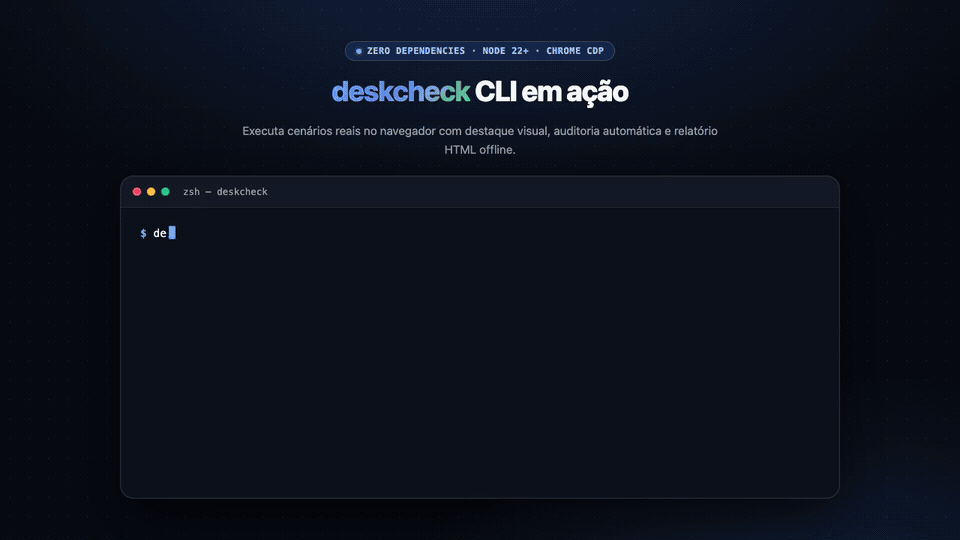

# deskcheck

Ferramenta de linha de comando para executar **desk checks** de histórias e bugs do Azure DevOps diretamente no navegador, gerando evidências com prints e um relatório HTML completo que funciona offline.

Não exige **PAT/token**, não precisa de **Playwright**, não precisa de **`npm install`** e funciona em **macOS, Windows e Linux**.

---

## Demonstração



> Quer assistir em alta definição (1280×720 · 30 fps)? Veja [docs/demo.mp4](docs/demo.mp4).

---

## Avaliação de qualidade

Pontuações da versão atual (`34/34` testes automatizados passando — unitários e ponta a ponta no Chrome):

| Dimensão avaliada | Nota (0–10) | Evolução |
|---|---:|---:|
| **Nota geral da aplicação** | **9,09 / 10** | `+0,47` (de 8,62) |
| **Didática, documentação e UX da CLI** | **9,07 / 10** | `+0,16` (de 8,91) |
| **Assertividade e confiabilidade do motor** | **8,94 / 10** | `+0,26` (de 8,68) |
| **Arquitetura, segurança e manutenibilidade** | **8,86 / 10** | `+1,22` (de 7,64) |
| **Design visual do relatório HTML** | **8,62 / 10** | estável |

---

## Sumário

1. [O que você precisa antes de começar](#1-o-que-você-precisa-antes-de-começar)
2. [Teste em 1 minuto (sem usar o Azure)](#2-teste-em-1-minuto-sem-usar-o-azure)
3. [Passo a passo de um desk check real](#3-passo-a-passo-de-um-desk-check-real)
4. [Como montar o `plan.json` (exemplo explicado)](#4-como-montar-o-planjson-exemplo-explicado)
5. [Ações mais usadas nos cenários](#5-ações-mais-usadas-nos-cenários)
6. [Como ler o relatório (`report.html`)](#6-como-ler-o-relatório-reporthtml)
7. [Modo somente leitura (seguro para UAT e PRD)](#7-modo-somente-leitura-seguro-para-uat-e-prd)
8. [Escrita opcional no Azure (em 2 etapas)](#8-escrita-opcional-no-azure-em-2-etapas)
9. [Dúvidas frequentes e solução de problemas](#9-dúvidas-frequentes-e-solução-de-problemas)

---

## 1. O que você precisa antes de começar

| Requisito | Como conferir |
|---|---|
| **Node.js 22 ou superior** | Rode `node -v` no terminal (ex.: `v22.x.x` ou maior) |
| **Google Chrome, Chromium ou Microsoft Edge** | Já instalado na máquina (ou informe o caminho em `CHROME_PATH`) |

**Instalação:** basta clonar este repositório. Como ele não tem dependências externas, **não é preciso rodar `npm install`**.

Se quiser digitar apenas `deskcheck` em qualquer pasta do terminal (em vez de `node bin/deskcheck.mjs`), rode uma vez na raiz do repositório:

```sh
npm link
```

> Nos exemplos abaixo usamos `node bin/deskcheck.mjs` porque funciona imediatamente, mesmo sem `npm link`.

---

## 2. Teste em 1 minuto (sem usar o Azure)

Antes de testar uma história real, rode a tela de demonstração que já vem pronta no repositório para ver o Chrome sendo controlado e o relatório abrindo no final.

**macOS / Linux:**

```sh
node bin/deskcheck.mjs run --plan skill/examples/plan.json --url "file://$PWD/test/fixtures/" --dir test/out
```

**Windows (PowerShell):**

```powershell
$fixtures = (Resolve-Path test\fixtures).Path -replace '\\','/'
node bin/deskcheck.mjs run --plan skill/examples/plan.json --url "file:///$fixtures/" --dir test/out
```

O que vai acontecer:
1. Uma janela própria do Chrome vai abrir e executar 4 cenários automaticamente (com um painel no canto mostrando cada passo e destaque visual no elemento clicado).
2. Ao terminar, o relatório [test/out/report.html](test/out/report.html) abre sozinho no seu navegador (3 cenários passam e 1 falha de propósito para mostrar o diagnóstico de erro).

Para rodar toda a suíte automatizada de testes do projeto:

```sh
npm test
```

---

## 3. Passo a passo de um desk check real

Cada card validado fica organizado em uma pasta separada dentro de `.deskcheck/<id>/` (essa pasta é ignorada automaticamente pelo Git).

### Passo 1 — Fazer login no Azure DevOps (apenas uma vez)

```sh
node bin/deskcheck.mjs login
```

- Vai abrir uma janela própria do Chrome na página do Azure DevOps (`dev.azure.com`).
- Faça o login corporativo (SSO) normalmente e **feche a janela do Chrome** quando terminar.
- A sessão fica salva no perfil isolado em `~/.cache/deskcheck/chrome` (não mexe no seu Chrome pessoal).

Para confirmar que o login está ativo:

```sh
node bin/deskcheck.mjs whoami
```

> Se a aplicação que você vai testar (local, dev, UAT ou PRD) também exigir login, rode uma vez:
> ```sh
> node bin/deskcheck.mjs login --url https://endereco-da-aplicacao
> ```

### Passo 2 — Baixar os dados do card do Azure

Troque `10042` pelo número da sua User Story, Technical Story, Feature ou Bug e informe sua organização e projeto do Azure DevOps:

```sh
export DESKCHECK_ORG="sua-organizacao"
export DESKCHECK_PROJECT="seu-projeto"

node bin/deskcheck.mjs card 10042
```

Isso cria a pasta do card com tudo pronto para começar:

```text
.deskcheck/10042/
├── card.md              # resumo legível (critérios de aceite, Test Cases, Defects)
├── card.json            # dados estruturados do card
└── plan.template.json   # modelo inicial do plano de testes já preenchido com ACs e TCs
```

> Você também pode passar `--org <org> --project <proj>` diretamente em qualquer comando do Azure (`login`, `whoami`, `card`, `apply`).

### Passo 3 — Explorar a tela antes de montar o plano

Com a sua aplicação rodando (por exemplo em `http://localhost:3000`), mapeie os elementos reais da página em vez de adivinhar seletores:

```sh
node bin/deskcheck.mjs explore http://localhost:3000/sua-rota --out .deskcheck/10042/explore --draft
```

Esse comando imprime os títulos, botões, campos (com papel e nome acessível), `data-testid` disponíveis, salva um print em `.deskcheck/10042/explore/explore.png` e (com `--draft`) já cria um rascunho funcional em `plan.draft.json` para acelerar a montagem do plano.

### Passo 4 — Criar o arquivo `plan.json`

Copie `.deskcheck/10042/plan.template.json` para `.deskcheck/10042/plan.json` e preencha os passos de cada cenário (veja o exemplo explicado na [Seção 4](#4-como-montar-o-planjson-exemplo-explicado)).

### Passo 5 — Executar o desk check

```sh
node bin/deskcheck.mjs run --plan .deskcheck/10042/plan.json --url http://localhost:3000 --strict
```

Opções úteis no `run`:

| Flag | Para que serve |
|---|---|
| `--strict` | Recomendado: rebaixa cenários que tenham erro JS no console, resposta HTTP 5xx, imagem quebrada ou barra de rolagem horizontal inesperada |
| `--retries 1` | Reexecuta automaticamente cenários que falharem por instabilidade momentânea (marca como `flaky` se passar na nova tentativa) |
| `--fail-on-error` | Sai com código `1` quando houver falha ou bloqueio (já liga sozinho em ambientes `CI`) |
| `--junit` | Gera também relatório JUnit XML (`junit.xml`, ou passe `--junit caminho.xml`) para pipelines |
| `--only S2,S3` | Reexecuta somente os cenários informados, mantendo os resultados dos outros |
| `--headless` | Roda em segundo plano sem abrir a janela do Chrome (ideal para CI) |
| `--slow 800` | Ajusta o intervalo entre passos em milissegundos (padrão: `500` ms na tela) |
| `--width 390 --height 844` | Define a resolução da tela (útil para validar mobile) |
| `--no-open` | Não abre o `report.html` automaticamente ao final |

Ao terminar, os arquivos da execução ficam salvos em `.deskcheck/10042/`:

```text
.deskcheck/10042/
├── report.html          # relatório visual completo e offline (compartilhável)
├── report.md            # resumo em Markdown
├── results.json         # resultado detalhado de cada passo, rede, console e auditoria
└── shots/               # prints de evidência em PNG (e cópias leves em shots/web/)
```

### Passo 6 — Revisar os prints e ajustar veredito (se necessário)

As asserções validam textos, valores, contagens e chamadas de rede, mas sempre dê uma olhada nos prints para conferir alinhamento e detalhes de layout.

Se quiser registrar manualmente uma observação ou mudar o status de um cenário (sem editar o JSON na mão):

```sh
node bin/deskcheck.mjs verdict S2 --status fail --note "Título cortado no card em 1280px" --dir .deskcheck/10042
```

Para voltar ao status automático:

```sh
node bin/deskcheck.mjs verdict S2 --status auto --dir .deskcheck/10042
```

O `report.html` e o `report.md` são atualizados na hora.

---

## 4. Como montar o `plan.json` (exemplo explicado)

```json
{
  "workItem": 10042,
  "title": "Filtro de status na lista de parceiros",
  "baseUrl": "http://localhost:3000",
  "viewport": { "width": 1440, "height": 900 },
  "beforeEach": [
    { "do": "goto", "url": "/parceiros" }
  ],
  "notTestable": [
    { "ref": "AC-3", "reason": "Depende de cadastro no CMS fora do ambiente local" }
  ],
  "scenarios": [
    {
      "id": "S1",
      "title": "Lista abre com todos os parceiros",
      "ac": ["AC-1"],
      "tc": [10201],
      "expected": "O filtro abre em All Status e exibe 3 itens na tabela.",
      "steps": [
        { "do": "expectValue", "label": "Filter by status", "value": "All Status" },
        { "do": "expectCount", "selector": "[data-testid=row]", "count": 3 },
        { "do": "screenshot", "label": "Tela inicial" }
      ]
    },
    {
      "id": "S2",
      "title": "Filtrar por Approve chama a API e reduz a lista",
      "ac": ["AC-2"],
      "expected": "Ao filtrar por Approve, a API retorna 200 e apenas parceiros aprovados aparecem.",
      "steps": [
        { "do": "select", "label": "Filter by status", "value": "Approve" },
        { "do": "click", "role": "button", "name": "Apply" },
        { "do": "expectRequest", "method": "GET", "urlContains": "/partners?status=approve", "status": "2xx" },
        { "do": "expectText", "text": "Filters applied" },
        { "do": "expectNoText", "text": "Partner Beta" },
        { "do": "screenshot", "label": "Filtrado por Approve" }
      ]
    }
  ]
}
```

### Entendendo cada campo

- **`workItem`**: número do card no Azure (liga o plano à pasta `.deskcheck/<id>/`).
- **`baseUrl`**: endereço base da aplicação (pode ser sobrescrito com `--url` no `run`).
- **`beforeEach`**: passos executados automaticamente no início de **todo** cenário.
- **`notTestable`** *(opcional)*: itens de AC ou TC que não podem ser testados naquele ambiente — aparecem no relatório com o motivo explicado.
- **`scenarios`**: lista de testes. Cada cenário abre em uma nova aba (mantendo cookies/sessão):
  - **`id`** e **`title`**: identificador único (`S1`, `S2`...) e nome legível.
  - **`ac`** e **`tc`** *(opcionais)*: vincula o cenário aos critérios (`["AC-1"]`) e Test Cases (`[10201]`) do card para montar a matriz de cobertura.
  - **`expected`**: frase curta dizendo o resultado esperado.
  - **`reference`** *(opcional)*: imagem de referência (ex.: export do Figma) para comparar **Referência × Tela** lado a lado no relatório.
  - **`steps`**: sequência de ações e asserções.

---

## 5. Ações mais usadas nos cenários

### Como localizar um elemento

Prefira localizar pelo que o usuário enxerga na tela (nunca use classes geradas com hash como `.sc-a1b2c3`):

| Forma | Exemplo | Quando usar |
|---|---|---|
| `role` + `name` | `{ "role": "button", "name": "Apply" }` | Botões, links, abas, caixas de diálogo, opções |
| `label` | `{ "label": "Filter by status" }` | Campos de formulário pelo rótulo ou `aria-label` |
| `placeholder` | `{ "placeholder": "Search partner" }` | Inputs identificados pelo placeholder |
| `text` | `{ "text": "Pending my actions" }` | Textos visíveis na tela |
| `selector` | `{ "selector": "[data-testid=row]" }` | `data-testid`, `id` ou atributos estáveis |

### Ações de interação

| Ação (`do`) | Exemplo | O que faz |
|---|---|---|
| `goto` | `{ "do": "goto", "url": "/rota" }` | Abre a página e aguarda rede e DOM estabilizarem |
| `click` | `{ "do": "click", "role": "button", "name": "Salvar" }` | Clica no elemento (falha se estiver coberto por modal/overlay) |
| `fill` | `{ "do": "fill", "label": "Busca", "value": "Brasil" }` | Limpa e digita no campo (`value: ""` apaga) |
| `select` | `{ "do": "select", "label": "Status", "value": "Approve" }` | Seleciona opção em `<select>` nativo |
| `check` | `{ "do": "check", "label": "Ativo", "value": true }` | Marca/desmarca checkbox ou radio |
| `press` | `{ "do": "press", "key": "Enter" }` | Pressiona teclas ou atalhos (`Shift+Tab`, `Control+A`, `Escape`) |
| `wait` | `{ "do": "wait", "gone": "Carregando..." }` | Espera um tempo (`ms`), um elemento aparecer ou um texto sumir |
| `upload` | `{ "do": "upload", "label": "Anexo", "file": "comprovante.png" }` | Envia arquivo(s) para `<input type="file">` (inclusive ocultos) |
| `dialog` | `{ "do": "dialog", "action": "dismiss" }` | Define a resposta do próximo `alert` / `confirm` / `prompt` (padrão: aceitar sem travar) |
| `screenshot` | `{ "do": "screenshot", "label": "Estado final" }` | Tira print limpo de evidência (também aceita `fullPage: true`) |

### Asserções (o que realmente valida o cenário)

| Asserção (`do`) | Exemplo | O que valida |
|---|---|---|
| `expectText` | `{ "do": "expectText", "text": "Salvo com sucesso" }` | Confirma que o texto está visível |
| `expectNoText` | `{ "do": "expectNoText", "text": "Erro" }` | Confirma que o texto não aparece |
| `expectVisible` / `expectHidden` | `{ "do": "expectVisible", "role": "dialog" }` | Confirma se o elemento está visível ou oculto |
| `expectValue` | `{ "do": "expectValue", "label": "Total", "value": "42" }` | Confirma o valor de um campo |
| `expectCount` | `{ "do": "expectCount", "selector": "[data-testid=card]", "min": 1 }` | Confirma quantidade exata (`count`) ou faixa (`min`/`max`) |
| `expectUrl` | `{ "do": "expectUrl", "contains": "/detalhes" }` | Confirma o endereço atual |
| `expectRequest` | `{ "do": "expectRequest", "method": "GET", "urlContains": "/api/items", "status": "2xx" }` | Confirma que a tela chamou a API esperada com o status certo |
| `expectEval` | `{ "do": "expectEval", "expr": "document.title.includes('Dashboard')" }` | Valida condição customizada em JS |

> Qualquer passo aceita `"optional": true` (se falhar vira ressalva em vez de reprovar), `"timeout": 10000` e `"shot": "rótulo"` para tirar print logo após o passo.
>
> A referência completa de todas as ações está em [skill/references/plan-format.md](skill/references/plan-format.md).

---

## 6. Como ler o relatório (`report.html`)

O arquivo `report.html` é **100% autocontido** (as imagens ficam embutidas dentro dele). Você pode abrir direto no navegador ou enviar para alguém do time sem precisar de servidor.

Ele mostra:
- **Veredito geral** (`Aprovado`, `Aprovado com ressalvas`, `Reprovado` ou `Incompleto`) e contagem por status:
  - **Passou (`pass`)**: todas as asserções passaram.
  - **Ressalva (`warn`)**: passou com algum passo opcional falhando ou alerta de revisão.
  - **Falhou (`fail`)**: uma asserção ou critério `--strict` falhou (já traz bloco de diagnóstico **Esperado × Obtido** e print do momento exato da falha).
  - **Bloqueado (`blocked`)**: não conseguiu executar uma ação (ex.: elemento inexistente/coberto ou ambiente fora do ar).
- **Índice de Confiança (Alta / Parcial / Baixa)**: mede automaticamente o quão rigoroso foi o desk check com base em cobertura de ACs/TCs, presença de asserções objetivas, validação de API, ausência de erros de console/rede e auditoria visual.
- **O que precisa de atenção**: lista clicável com tudo o que exige olho humano (falhas, erros de console/rede, alertas visuais, ACs/TCs sem cenário).
- **Evidências interativas**: cada print mostra as **marcações automáticas** onde os cliques e asserções aconteceram (com botão para ligar/desligar), lightbox com zoom e, quando houver imagem de referência, comparação **Lado a lado / Cortina / Diferença**.

---

## 7. Modo somente leitura (seguro para UAT e PRD)

Sempre que a URL testada **não** for `localhost` / `127.0.0.1`, o modo somente leitura é ativado automaticamente:

- Todo `POST`, `PUT`, `PATCH` e `DELETE` é interceptado e bloqueado dentro do Chrome (em todas as abas, iframes e workers) antes de chegar ao servidor.
- Somente o fluxo de autenticação (Microsoft, SAML e Keycloak) é permitido.
- Qualquer tentativa de escrita barrada aparece registrada no relatório.

Você também pode forçar esse modo localmente com `--readonly`.

Com `--allow-writes` a rede continua inspecionada: só passam escritas para `localhost` e para hosts de teste (`dev`, `stg`, `uat`...; outros via `DESKCHECK_WRITE_HOSTS`). Qualquer outro destino segue barrado, e um plano que aponte para um host fora de teste é recusado antes de abrir o Chrome.

### Trocar o papel do próprio usuário em ambiente de teste

```sh
deskcheck role set 10042 --url https://app.dev.example.com/admin/users --roles editor
deskcheck role restore 10042
deskcheck role status 10042
```

`role set` guarda o cadastro original em `.deskcheck/<id>/user-original.json` na primeira troca, altera só o usuário logado e confere pela API que a troca valeu. `role restore` devolve o cadastro original e confere que ficou idêntico. O comando recusa hosts que não sejam de teste.

---

## 8. Escrita opcional no Azure (em 2 etapas)

Por padrão, o `deskcheck` **nunca altera nada no Azure DevOps** — ele apenas lê o card e gera o relatório.

Se você quiser abrir um Defect, anexar evidências em um Test Case ou marcar o campo Desk Check da história, o processo sempre exige **duas etapas** (prévia + confirmação):

```sh
# 1ª etapa: monta a prévia e devolve um código temporário (ex.: A7K2) — ainda NÃO grava nada
node bin/deskcheck.mjs defect 10042 --scenario S2 --title "Status filter is not sent to API"
node bin/deskcheck.mjs evidence 10201 --close
node bin/deskcheck.mjs mark 10042

# Ver ações pendentes ou descartar uma ação
node bin/deskcheck.mjs pending
node bin/deskcheck.mjs discard A7K2

# 2ª etapa: validar sem gravar (recomendado na 1ª vez)
node bin/deskcheck.mjs apply A7K2 --validate-only

# Gravar de fato no Azure
node bin/deskcheck.mjs apply A7K2
```

> O código expira em 1 hora e é automaticamente invalidado se o texto ou qualquer print for alterado depois da prévia.

---

## 9. Dúvidas frequentes e solução de problemas

- **Erro `"o Chrome fechou ao abrir"`**  
  O perfil `~/.cache/deskcheck/chrome` só pode ser usado por um Chrome por vez. Feche qualquer janela anterior aberta pelo `deskcheck` (ou outra execução rodando) e tente novamente.

- **Erro `"Chrome não encontrado"`**  
  Defina a variável de ambiente `CHROME_PATH` apontando para o executável do Chrome, Chromium ou Edge:
  - macOS: `CHROME_PATH="/Applications/Google Chrome.app/Contents/MacOS/Google Chrome"`
  - Windows (PowerShell): `$env:CHROME_PATH="C:\Program Files\Google\Chrome\Application\chrome.exe"`
  - Linux: `CHROME_PATH="/usr/bin/google-chrome"`

- **O comando falha com erro de sintaxe ou recurso não encontrado no Node**  
  Confira `node -v`. A ferramenta usa recursos nativos do **Node.js 22+** (`WebSocket` nativo, `node:test`, etc.).

- **A tela que estou testando pede login antes de mostrar o conteúdo**  
  Rode `node bin/deskcheck.mjs login --url <endereço-da-tela>`, faça login uma vez na janela que abrir, feche o Chrome e rode o `run` normalmente.

- **Como usar junto com a documentação operacional (`skill/`)**  
  O fluxo detalhado está em [skill/SKILL.md](skill/SKILL.md). Para copiar o pacote para `~/.agents/skills/deskcheck`:
  ```sh
  npm run sync-skill
  ```
  Opcionalmente, defina `DESKCHECK_SKILL` para mudar a pasta de destino e `DESKCHECK_SKILL_LINKS` (caminhos separados por `:` no macOS/Linux ou `;` no Windows) para criar links simbólicos adicionais.

## Esteira (pipeline)

A pasta [`pipeline/`](pipeline/README.md) traz um app local que faz o desk check de ponta a ponta a partir do link de um card: lê o card e os Test Cases, acha o pull request, prepara uma worktree isolada, chama um agente de linha de comando para rodar os cenários no Chrome e mostra o veredito com os prints marcados.

```sh
yarn          # prepara: cria pipeline/pipeline.config.json a partir do exemplo (se não houver) e confere o ambiente
yarn dev      # sobe e abre http://localhost:4310
yarn start    # só sobe
yarn doctor   # confere se o ambiente está pronto
```

O projeto não tem dependências de npm. A configuração do seu time fica fora do repositório: em `pipeline/pipeline.config.json` ou, para valer em qualquer clone da máquina, em `~/.config/deskcheck/pipeline.config.json`. Node 22+, Google Chrome, `gh` logado e um agente de linha de comando precisam estar instalados; o `yarn` avisa o que faltar.
